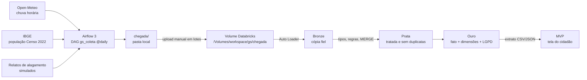

# Alerta de Chuva Forte e Alagamento · Grande SP

**GS 2026.2 · CitizenTech · Big Data Architecture & Data Integration**

## Integrantes

| Nome completo | RM |
|---|---|
| Arthur Baldissera Claumann Marcos | RM550219 |
| Victor Kenzo Toma | RM551649 |
| Ricardo Ramos Vergani | RM550166 |
| Pedro Barros | RM97937 |


## O produto em uma frase

Um app que avisa o cidadão de São Paulo quando vai chover forte no município dele e mostra onde outros cidadãos estão relatando alagamento, para ele planejar o deslocamento com segurança.

### Perguntas que o MVP responde

1. Vai chover forte hoje no meu município? A partir de que horas?
2. Quais municípios tiveram mais horas de chuva forte nos últimos 30 dias?
3. Em que horário do dia a chuva forte costuma cair?
4. Onde os cidadãos mais relatam alagamento, e isso bate com a chuva medida?
5. **Impacto:** quantas pessoas o alerta protege?

## Arquitetura



O Databricks Free Edition não se conecta ao Airflow: o DAG grava em `chegada/` e os arquivos sobem ao Volume pela interface, em lotes.

## Fontes de dados

| Fonte | Origem | Formato | Frequência | Chave? | Pergunta do MVP |
|---|---|---|---|---|---|
| Open-Meteo (real) | `https://api.open-meteo.com/v1/forecast` | JSON (gravado como JSON Lines, 1 linha por município) | diária, 24 horas por coleta | não | 1, 2, 3, 4, 5 |
| IBGE (real) | `https://servicodados.ibge.gov.br/api/v3/agregados/4709/periodos/2022/variaveis/93` | JSON (JSON Lines, 1 linha por município) | diária (cadastro estável; a Prata deduplica) | não | 2, 5 |
| Relatos de alagamento (**simulado**) | gerador `gerar_linhas_relatos` em `dags/gs_coleta.py` | JSON Lines, 1 linha por relato | diária | token em Variable `GS_TOKEN_API_RELATOS` | 4, 5 |

As fontes se cruzam pelo **código IBGE do município** e pela **data/hora**.

**Sobre os dados simulados.** Os relatos representam o que o app receberia dos cidadãos. O gerador:
- lê a chuva real do mesmo dia: mais chuva gera mais relatos e água mais alta; a chuva da hora anterior também conta (a água demora a escoar);
- dá a cada município um fator de drenagem fixo (alguns alagam mais);
- usa semente fixa por dia, então rodar de novo gera o mesmo arquivo;
- injeta ~3% de registros com defeito (sem data, município inexistente, GPS zerado) e ~2% de reenvios duplicados, para exercitar as regras de qualidade e a deduplicação da Prata;
- gera **somente dados pessoais fictícios** (nomes aleatórios, e-mails no domínio reservado `.invalid`).

## Estrutura do repositório

```
dags/gs_coleta.py            DAG do Airflow (coleta + gerador de relatos)
databricks/00_setup.ipynb       schema, Volume e pastas
databricks/01_bronze.ipynb      Auto Loader incremental + contagens
databricks/02_prata.ipynb     tipos, regras de qualidade, quarentena, MERGE
databricks/03_ouro.ipynb       star schema, LGPD, 5 consultas, extrato para o MVP
mvp/index.html               o mvp funcionando com os dados do mvp_alertas.json
amostras/                    um arquivo de cada fonte
docker-compose.yaml          oficial do Airflow 3
docker-compose.override.yml  monta a pasta chegada/ nos containers
```

## Como reproduzir

### 1. Airflow (máquina local)

Pré-requisitos: Docker Desktop (com WSL 2 no Windows, pelo menos 4 GB de RAM para o Docker) e Git.

```bash
git clone <este repositório> && cd <pasta>
cp .env.example .env               # Windows: copy .env.example .env
curl -LfO https://airflow.apache.org/docs/apache-airflow/stable/docker-compose.yaml   # Windows: curl.exe
mkdir -p logs plugins config chegada
docker compose up airflow-init
docker compose up -d
```

1. Abra http://localhost:8080 (usuário `airflow`, senha `airflow`).
2. **Admin → Variables → +**: chave `GS_TOKEN_API_RELATOS`, valor qualquer texto. O nome contém `TOKEN`, então o Airflow oculta o valor.
3. Ative o DAG `gs_coleta`. Com `catchup=True` e `start_date` em 01/10/2026, ele coleta todos os dias desde então.
4. Os arquivos aparecem em `chegada/clima/`, `chegada/ibge/` e `chegada/relatos/`.

### 2. Databricks Free Edition

1. Importe os 4 arquivos de `databricks/` (Workspace → Import).
2. Rode `00_setup`. Crie um `sal.txt` com um texto aleatório e envie para `/Volumes/workspace/gs/chegada/_controle/` (**não** versionar).
3. **Lote 1:** envie ao Volume os arquivos de 01/10 a 20/10, cada um na subpasta da sua fonte. Rode `01_bronze` com `MOMENTO = "1 - apos lote 1"`.
4. **Lote 2:** envie os arquivos de 21/10 em diante. Rode `01_bronze` com `MOMENTO = "2 - apos lote 2"`.
5. Rode `01_bronze` de novo, sem arquivo novo, com `MOMENTO = "3 - reexecucao sem arquivo novo"`.
6. Rode `02_prata` **duas vezes** (a 2ª não insere nada).
7. Rode `03_ouro`. O extrato do MVP fica em `/Volumes/workspace/gs/chegada/_export/`.

## Camadas

| Camada | Tabelas | Chave / grão |
|---|---|---|
| Bronze | `bronze_clima`, `bronze_ibge`, `bronze_relatos` | cópia fiel + `arquivo_origem`, `carregado_em` |
| Prata | `prata_clima` | `codigo_ibge` + `data_hora` |
| | `prata_ibge` | `codigo_ibge` |
| | `prata_relatos` (+ `prata_quarentena_relatos`) | `id_relato` |
| Ouro | `ouro_fato_chuva` | **uma linha por município por hora** |
| | `ouro_dim_tempo`, `ouro_dim_municipio`, `ouro_dim_intensidade` | `id_tempo`, `codigo_ibge`, `id_intensidade` |
| | `ouro_relatos` | relatos com dados pessoais protegidos |

**Regras de qualidade da Prata:** clima (data/hora nula · chuva nula ou negativa · temperatura fora de -10 a 50 °C), IBGE (código nulo · população inválida), relatos (data/hora nula · município fora do cadastro IBGE · coordenada fora da Grande SP). As contagens ficam em `prata_regras_qualidade`.

**Intensidade da chuva:** fraca < 2,5 mm/h · moderada 2,5 a 7,6 · forte 7,6 a 50 · violenta ≥ 50. Forte e violenta geram **alerta**.

## LGPD

| Dado pessoal | Onde aparece | Tratamento na Ouro |
|---|---|---|
| Nome | relatos | não levado adiante (minimização) |
| E-mail | relatos | hash `sha2(lower(email) + sal, 256)`; sal fora do código e do repositório |
| Telefone | relatos | máscara `(11) *****-1234` |
| Localização exata | relatos | arredondada a 3 casas decimais (~100 m) |

## Contrato com o MVP

- **Origem:** view `workspace.gs.ouro_vw_mvp_alertas`, exportada como `mvp_alertas.csv` e `mvp_alertas.json`.
- **Atualização:** diária, depois da carga dos lotes e da execução de `02_prata` e `03_ouro`.
- **Leitura pelo MVP:** o app carrega o extrato no seu banco ou lê o JSON diretamente. Nenhum dado pessoal vai para o MVP.

| Coluna | Tipo | Descrição |
|---|---|---|
| codigo_ibge | int | código IBGE do município |
| municipio | string | nome do município |
| populacao | bigint | população (Censo 2022) |
| latitude, longitude | double | ponto do município para o mapa |
| data_hora | timestamp | hora (America/Sao_Paulo) |
| data, hora, periodo_dia | date, int, string | recortes de tempo |
| chuva_mm | double | chuva na hora (mm) |
| intensidade | string | sem chuva, fraca, moderada, forte, violenta |
| em_alerta | boolean | true para chuva forte ou violenta |
| temperatura_c, rajada_kmh | double | contexto do tempo |
| qtd_relatos, qtd_relatos_agua_alta | bigint | relatos de alagamento na hora |
