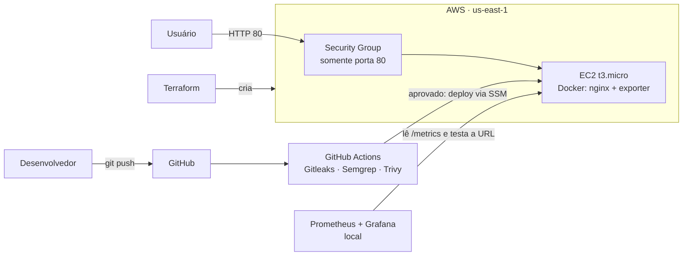

# Alerta de Chuva Forte e Alagamento · Grande SP

**GS 2026.2 · CitizenTech · Cloud**

## Integrantes

| Nome completo | RM |
|---|---|
| Arthur Baldissera Claumann Marcos | RM550219 |
| Victor Kenzo Toma | RM551649 |
| Ricardo Ramos Vergani | RM550166 |
| Pedro Barros | RM97937 |

## Deploy Blindado (DevSecOps)

### Ficha Técnica do MVP

| Item | Descrição |
|---|---|
| Nome | Alerta de Chuva Forte e Alagamento · Grande SP |
| Problema | Avisar o cidadão quando vai chover forte no município dele |
| O que está no ar | Página web estática (`mvp/`) com o extrato da camada Ouro |
| URL pública | http://54.85.25.247 |
| Nuvem | AWS (AWS Academy), região us-east-1, EC2 t3.micro |
| Stack | nginx (container), Docker Compose, Terraform, GitHub Actions, Prometheus, Grafana |
| Integrantes | <nomes e RMs, como na seção acima> |

### Arquitetura

### Como reproduzir

1. **Container local:** `docker compose -f docker-compose.mvp.yml up --build -d` e abra http://localhost.
2. **Infraestrutura:** coloque as chaves do AWS Academy em `~/.aws/credentials`, entre em `infra/`, copie `terraform.tfvars.example` para `terraform.tfvars` e rode `terraform init`, `terraform plan`, `terraform apply`.
3. **Pipeline:** em Settings → Secrets and variables → Actions, cadastre `AWS_ACCESS_KEY_ID`, `AWS_SECRET_ACCESS_KEY`, `AWS_SESSION_TOKEN` (mudam a cada Start Lab) e `INSTANCE_ID` (`terraform output instance_id`). Cada push roda Gitleaks, Semgrep e Trivy; na `main`, o deploy é automático.
4. **Monitoramento:** copie `monitoring/.env.example` para `monitoring/.env`, defina a senha do Grafana e rode `docker compose up -d` em `monitoring/`. Prometheus em http://localhost:9090 e Grafana em http://localhost:3000.

### Segurança aplicada

- Imagem enxuta (Alpine), usuário **não-root** (`nginx`), pacotes atualizados e nenhum segredo dentro da imagem.
- `terraform.tfstate`, `*.tfvars` e `.env` ficam fora do repositório (`.gitignore`).
- **Nenhuma porta de administração aberta.** O Security Group libera só a porta 80; não há SSH. O deploy usa AWS Systems Manager (SSM).
- Disco da instância criptografado e metadados da instância protegidos (IMDSv2).
- Ferramentas do pipeline fixadas por SHA de commit (proteção contra ataque à cadeia de suprimentos).
- **Exceção aceita no Semgrep:** o `proxy_pass` de `/metrics` tem destino fixo (não controlado pelo visitante), e a regra `missing-internal` foi marcada com `nosemgrep`.
- **Risco aceito:** `/metrics` é público, pois o Prometheus local precisa lê-lo pela URL. Ele expõe só contadores do nginx. Melhoria futura: restringir por IP ou usar autenticação.

### Observabilidade (4 sinais de ouro)

| Sinal | Como medimos |
|---|---|
| Latência | `probe_duration_seconds` (Blackbox Exporter, de fora) |
| Tráfego | `rate(nginx_http_requests_total[2m])` |
| Erros | % de checagens com falha (`probe_success`) |
| Saturação | `nginx_connections_active` (limite de 1024) |

Alerta `SiteForaDoAr`: dispara quando a checagem falha por 30 s. Foi testado simulando indisponibilidade (checagem apontada para uma porta fechada).

### Matriz de responsabilidade compartilhada

| Camada | AWS | Equipe |
|---|---|---|
| Datacenter, hardware, rede global, hipervisor | ✅ | |
| Mecanismo de firewall e de criptografia (EBS/KMS) | ✅ | |
| Regras do Security Group e ativar criptografia | | ✅ |
| Sistema operacional da instância e atualizações | | ✅ |
| Docker, imagem e dependências | | ✅ |
| Código do MVP e dados | | ✅ |
| Credenciais, segredos e pipeline | | ✅ |
| Monitoramento e resposta a alertas | | ✅ |

### LGPD: localização e proteção dos dados pessoais

- **No servidor da AWS (us-east-1) não há dados pessoais do cidadão.** O MVP publica só o extrato agregado por município (chuva, população, contagem de relatos).
- Dados pessoais existem **apenas na camada de relatos**, que é **simulada** (nomes aleatórios e e-mails `.invalid`), no pipeline Airflow/Databricks. Proteções na camada Ouro: nome removido (minimização), e-mail com hash e sal fora do repositório, telefone mascarado, localização arredondada (~100 m).
- Região do Databricks: <confira no seu workspace e escreva aqui>.
- O nginx registra o **endereço IP** de quem acessa (dado pessoal pela LGPD). Os logs ficam só no container, sem envio a terceiros, e são descartados quando o container é recriado.
- Disco do servidor criptografado, acesso administrativo só por SSM e menor privilégio no deploy.

### Estimativa de custo (AWS, us-east-1, uso 24x7)

| Item | Cálculo | US$/mês |
|---|---|---|
| EC2 t3.micro | 730 h × 0,0104 | ≈ 7,59 |
| IP público (Elastic IP) | 730 h × 0,005 | ≈ 3,65 |
| Disco EBS gp3 8 GB | 8 × 0,08 | ≈ 0,64 |
| Transferência de saída | tráfego baixo, dentro da franquia gratuita | ≈ 0 |
| **Total** | | **≈ 11,9** |

GitHub Actions (repositório público) e Prometheus/Grafana (rodam localmente) não têm custo. No AWS Academy não há cobrança real (orçamento do laboratório: US$ 50). Valores confirmados na AWS Pricing Calculator.